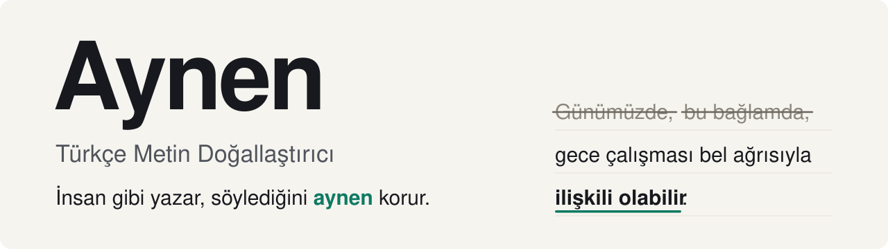

<picture>
  <source media="(prefers-color-scheme: dark)" srcset="assets/banner-dark.svg">
  <source media="(prefers-color-scheme: light)" srcset="assets/banner-light.svg">
  
</picture>

[](LICENSE)
[](#kurulum)
[](tests/regresyon.py)
[](SKILL.md)

Aynen, Türkçe metinlerdeki yapay zekâ izlerini temizleyen bir Claude skill'i, yani Claude'a bu işi nasıl yapacağını öğreten bir talimat ve araç paketi. Asıl işi, düzeltirken anlamın kaymasını önlemek. Çünkü yapay zekâyla "doğallaştırılan" bir metin akıcılaşırken sessizce başka bir şey söylemeye başlayabilir: "ilişkili olabilir" "artırır" olur, "önerilir" "zorunludur" olur, "anlamlı fark bulunmadı" "etkisi yok" olur, bir dipnot başka bir cümleye kayar. Aynen metni düzeltir, ardından sonucu kaynağıyla karşılaştıran bir denetimden geçirir. Adı da buradan geliyor: Yeni hâlini okuyunca "aynen, tam bunu demek istemiştim" diyebilesin diye.

## Bir paragraf, iki yeniden yazım

Örnek, bir iş sağlığı özetinden kısaltıldı.

**Önce**

> Bu bağlamda, söz konusu çalışmada bir lojistik deposunda çalışan 412 işçide gece vardiyası ile bel ağrısı arasındaki ilişki incelenmektedir. […] Bununla birlikte, yaş grupları arasında istatistiksel olarak anlamlı bir fark bulunmamıştır. Bu bulgular, gece çalışmasının bel ağrısı ile ilişkili olabileceğini düşündürmektedir. Sonuç olarak, vardiya planlamasında ergonomik risklerin göz önünde bulundurulması büyük önem taşımaktadır.

**Sıradan bir doğallaştırıcı:** Akıcı, izlerin çoğu gitmiş, ama başka bir şey söylüyor

> Bir lojistik deposundaki **421**<sup>1</sup> çalışanla yaptığımız bu çalışmada gece vardiyasının bel ağrısına etkisini inceledik. […] Yaşın ise **bir etkisi yoktu**<sup>2</sup>. Kısacası gece çalışması bel ağrısını **artırıyor**<sup>3</sup>, bu yüzden vardiyalar ergonomik risklere göre planlanmalı.

1. **412 → 421:** Sayı değişti. Denetim aracı bunu KESİN olarak yakalar.
2. **"anlamlı bir fark bulunmamıştır" → "bir etkisi yoktu":** Kanıt yokluğu, etkinin yokluğuna dönüştü.
3. **"ilişkili olabileceğini düşündürmektedir" → "artırıyor":** İlişki nedenselliğe, ihtiyatlı söyleyiş kesin yargıya dönüştü.

**Aynen:** Kalıplar gitti, söylenen aynı kaldı

> Bu çalışmada bir lojistik deposunda çalışan 412 işçide gece vardiyası ile bel ağrısı arasındaki ilişki incelenmektedir. […] Bununla birlikte, yaş grupları arasında istatistiksel olarak anlamlı bir fark bulunmamıştır. Bu bulgular, gece çalışmasının bel ağrısıyla ilişkili olabileceğini düşündürmektedir. Vardiya planlamasında ergonomik risklerin göz önünde bulundurulması çok önemlidir.

Tıbbi metinlerde Aynen varsayılan olarak az dokunur: Boş kalıpları siler, ama sayılara ve "olabilir", "düşündürmektedir" gibi ihtiyatlı sözlere dokunmaz. "Sıradan bir doğallaştırıcı" başlıklı ortadaki metin, anlam gözetilmeden yapılan bir düzeltmenin neleri bozduğunu göstermek için örnek olarak yazıldı. Üç metnin tam hâli ve ortadaki metnin bozduğu öteki yerler [`examples/06-tibbi-ozet.md`](examples/06-tibbi-ozet.md) dosyasında.

## Ne yapar, ne yapmaz

**Yapar:**
- "Günümüzde", "Bu bağlamda", "son derece kritik", "-mektedir" yığılması, çeviri kokan kalıplar ve İngilizce noktalama gibi izleri temizler.
- Metne ve isteğe göre ölçülü davranır:
  - Akademik, tıbbi ve hukuki metinde varsayılan seviye "hafif"tir.
  - Yapay zekâyla yazılmış bir taslakta hazır imgeleri ("görünmez bir zırh", "ruhsal çölleşme") ve tanıtım abartısını da sadeleştirir, ama iddianın gücünü korur.
  - Zaten doğal, insan elinden çıkmış bir metne çok az dokunur.
- Düzeltmeye başlamadan önce metni tarar ve kalıp listesindeki izlerden sözcükle bulunabilenleri paragraf paragraf gösterir.
- Sayıları, birimleri, istatistik değerlerini, kaynak gösterimlerini, dipnotları, hukuki atıfları, terimleri ve özel adları korur.
- "Olabilir" gibi ihtiyatlı sözleri, "bazı" ve "tüm" gibi kapsam sözlerini, olumsuzluğu, koşulu, "-meli" ile "-ebilir" arasındaki farkı, zamanı ve bilginin görülerek mi duyularak mı aktarıldığını (-dı/-mış) korur.
- Sonucu en çok üç katmanda denetler:
  - bir denetim aracı
  - kaynaktaki her iddianın yeni metinde, yeni metindeki her iddianın da kaynakta karşılığı olup olmadığına bakan iki yönlü bir kontrol
  - akademik, tıbbi, hukuki ve resmî metinlerde ya da istendiğinde, yalnızca iki metni gören ayrı bir yapay zekâ denetçisi

**Yapmaz:**
- Yapay zekâ dedektörlerinden geçeceğine dair söz vermez. Dedektörler güvenilir değildir; Aynen yalnızca metni doğallaştırır.
- Kaynak metin olmadan sıfırdan yazmaz.
- Hiçbir aşaması sıfır hata garantisi vermez. Son okuma yazarındır.

## Skill ve denetim aracı

Aynen iki parçadan oluşur. Denetim aracını tek başına da kullanabilirsin.

| | Skill | Denetim aracı (`scripts/anlam_denetimi.py`, Python ile yazılmış küçük bir program) |
|---|---|---|
| Ne yapar | Metni yeniden yazar ve denetler | Yalnızca iki metni karşılaştırır |
| Metni değiştirir mi | Evet | Hayır |
| Ne zaman | Metin yapay duruyor, düzelsin istiyorsun | Metin zaten değişti, anlam korundu mu bilmek istiyorsun |
| Maliyet | Yüksek (model okur, yazar, denetler) | Neredeyse sıfır (bir saniyelik program) |

Denetim aracı, metni kimin değiştirdiğine bakmaz. Bir danışmanın, editörün ya da başka bir yapay zekânın düzelttiği metni de denetleyebilir.

## Kurulum

**Claude Code:**

```bash
git clone https://github.com/drmehmetfarukucum/aynen ~/.claude/skills/aynen
```

**claude.ai:** Klasörü zip olarak sıkıştırıp Ayarlar'daki skill yükleme bölümünden ekleyebilirsin. Denetim aracı ve ayrı denetçi, komut çalıştırabilen ve yardımcı bir yapay zekâ (alt ajan) başlatabilen ortamlarda tam çalışır. Bunların olmadığı bir ortamda skill, denetimi elle yapar.

**Gereksinim:** Python 3.9 ya da üstü. Yalnızca standart kitaplık kullanılır; denetim aracı internete çıkmaz, dosya yazmaz.

## Kullanım

Claude'a metni verip şöyle demen yeter:
- "Şunu doğallaştır, yapay zekâ gibi durmasın."
- "Tez özetimi düzelt, anlam değişmesin."
- "Bu duyuruyu insanlaştır."

Uzun belgelerde (tez, kitap bölümü, uzun rapor) skill, uzun belge moduna geçer:
- Asıl dosyaya dokunmadan kopya üzerinde çalışır.
- Önce bölüm planı çıkarır ve kalıp listesindeki izleri paragraf paragraf tarar.
- Her değişikliği bir Önce/Sonra tablosuyla onaya sunar.
- Projenin kendi yazım kılavuzu varsa ona uyar.

### Denetim aracını tek başına kullanmak

```bash
python3 -I scripts/anlam_denetimi.py eski.txt yeni.txt
```

Çıktının anlamı:
- **KESİN:** Değişen ya da kaybolan sayı, birim, dipnot, hukuki atıf, bağlantı, DOI, alıntı, özel ad ya da korunan terim; yeni metne giren görünmez karakter. Düzeltilmesi gerekir.
- **KONTROL:** Sayısı değişen ya da başka cümleye geçen anlam sözleri: "olabilir" gibi ihtiyatlı sözler, olumsuzluk, "-meli" ile "-ebilir" farkı, koşul, olay sırası. Tek tek bakılmalı.
- **HEDEFLİ SORULAR:** Aracın kesin olarak yakalayamadığı kaymalar için riskli cümlelere sorulan sorular: "Hangi olay önce?", "Kim kime ne yaptı?"

Seçenekler:
- `--fark`: Değişen cümlelerin Önce/Sonra tablosunu ekler.
- `--koru "Başlık;Başka başlık"`: Bu başlıkların altındaki bölümler birebir aynı kalmalıdır. Kaynakça kendiliğinden korunur.
- `--terimler "spirometri;bilinçli taksir"` ya da `--terimler terimler.txt`: Bu terimler yeni metinde eksilirse KESİN uyarı verir. Ekli biçimler de sayılır ("spirometriyle"). Kısaltmalar ve büyük harfle yazılan adlar bu seçenek olmadan da denetlenir.

Sohbet ekranından kopyalanan metinde kalan görünmez karakterler (sıfır genişlikli boşluk, yumuşak tire) ve "【4†source】" gibi kaynak işaretleri karşılaştırmada yok sayılır, yeni metinde kalırsa bildirilir.

Çıkış kodu 0 ise KESİN uyarı yoktur, 1 ise vardır, 2 ise komut yanlış kullanılmıştır.

İki yardımcı komut daha var. İkisi de belgeye dokunmaz:
- `python3 -I scripts/bolumle.py belge.md`: Uzun belgelerde bölüm planını ve sözcük sayılarını çıkarır.
- `python3 -I scripts/tarama.py belge.md`: Kalıp listesindeki izlerden sözcükle bulunabilenleri satır ve kalıp kimliğiyle listeler. Üçlü sıralama ya da ritim gibi yapısal izleri göremez; bunlar metni okurken bulunur.

## İçinde neler var

- **`SKILL.md`:** Neyin değişmeyeceğini sayan kurallar (anlam sözleşmesi), öncelik sırası, düzeltme seviyeleri (hafif, orta, derin), çalışma adımları ve denetim adımları.
- **`references/kaliplar.md`:** Yapay zekâyla yazılmış Türkçe metinlerde sık görülen 51 kalıbın açıklamalı listesi. Her kalıpta belirti, neden yapay göründüğü, ne yapılacağı, hangi metin türünde olağan sayıldığı, anlam riski ve bir örnek var. Kümeler: açılış ve kapanış, klişe ve dolgu, dil bilgisi, yapı ve ritim, çeviri etkisi, noktalama, biçim, ton.
- **`references/anlam-kaymasi.md`:** Türkçede anlamın kayabileceği 23 durum. Her biri bir kayma örneği, güvenli biçim ve kontrol sorusuyla verilmiş. Ele alınan konulardan bazıları:
  - ihtiyatlı sözler
  - olumsuzluk ("ne … ne")
  - "-meli", "-ebilir", "önerilir" farkı
  - koşul ve istisna ("-saydı")
  - "-ınca", "-arak", "-ıp" gibi eklerin kurduğu zaman, sebep ve tarz bağları
  - "her çalışana ikişer" gibi dağıtma sözleri
  - kimin kime ne yaptığı
  - görüşün sahibi ("kanaatimizce")
  - olan hukuk ile olması gereken hukuk
- **`references/yazim-noktalama.md`:** TDK'nin yazım kuralları sayfalarına dayanan yazım ve noktalama rehberi. İngilizce tipografiden gelen izleri ve noktalamanın anlamı değiştirdiği yerleri de anlatır.
- **`references/baglaclar-ve-gecisler.md`:** Bağlaçların hangi ilişkiyi kurduğunu gösteren bir liste; eş anlamlı sanılan ama farklı anlam taşıyan çiftler.
- **`references/cumle-ritmi.md`:** Tekdüze ritmi kırma araçları ve dönüşümlerin anlam uyarıları.
- **`references/dogrulama.md`:** Ayrı denetçinin talimatı.
- **`references/uzun-belge.md`:** Tez ve uzun belgeler için iş akışı.
- **`scripts/anlam_denetimi.py`:** İki metni anlam bakımından karşılaştıran denetim aracı. Denetledikleri: sayılar, birimler, dipnotlar, hukuki atıflar, bağlantılar ve DOI'ler, korunan terimler, görünmez karakterler, ihtiyatlı sözler, olumsuzluk, "-meli" ile "-ebilir" farkı, koşul, olay sırası. Yalnızca standart kitaplıkla çalışır.
- **`scripts/bolumle.py`:** Uzun belgeler için bölüm planı çıkarır.
- **`scripts/tarama.py`:** Düzeltmeye başlamadan önce kalıp listesindeki izleri paragraf paragraf arar.
- **`examples/`:** Altı metin türü için tam örnek: iş sağlığı duyurusu, iş e-postası, tez özeti, ürün metni, kişisel paylaşım, tıbbi özet. Her örnekte düzeltilen kalıplar, bilinçli olarak korunanlar ve anlamı kaydıracak kötü yeniden yazımlar gösterilir.
- **`tests/` ve `evals/`:** Denetim aracını sınayan 195 hazır metin çifti (her biri için aracın vermesi gereken uyarı önceden belirlenmiş; 38'i ayrı bir projenin, text-forensics'in test kümesinden), ön taramayı sınayan 7 test ve skill'in bütün olarak sınandığı 9 senaryo.

Kalıp, yazım, bağlaç ve ritim dosyaları şu kaynaklar okunarak yazıldı: TDK'nin yazım kuralları ve sözlüğü, Türkçe dil bilgisi kaynakları, DergiPark'taki çalışmalar ve yapay zekâ metinleri üzerine akademik araştırmalar. Anlam kayması dosyasındaki kuralların çoğu Aynen'in kendi anlam koruma ilkesidir; dil bilgisi dayanakları öteki dosyalarda. Bu beş dosyanın sonunda kaynakçası var.

## Nasıl sınandı

- Codex, ChatGPT ve Gemini ile bağımsız incelemeler yapıldı.
- Skill yedi zorlayıcı senaryoda sınandı:
  - uzun Markdown belgesi
  - mevzuat dili
  - "yarıya kısalt" baskısı
  - denetim aracının çalışmadığı ortam
  - karışık dil ve sayılar
  - ince anlam yükü taşıyan sözcükler
  - zaten iyi yazılmış metin
- Tasarım kararları art arda sorularla zorlandı.

Uzun bir hukuk tezinin giriş bölümünde (yaklaşık 3.300 sözcük, 40 dipnot) yapılan denemede Aynen yalnızca iki cümleyi değiştirdi. Denetim aracı sorun bulmadı, ayrı denetçi de anlamın korunduğunu doğruladı. Aynı bölüm yeni akışla yeniden işlendiğinde yaklaşık %25 daha az token harcandı; çıktı aynı kaldı. Yeni akışta metin önce taranıyor, kalıp dosyasının yalnızca gereken kısmı okunuyor ve iddialar yalnızca değişen paragraflarda tek tek sayılıyor.

### Daha önce görmediği metinlerle

Aynen'in hiç görmediği 16 metin kullanıldı: internetten alınan 8 gerçek metin (banka basın bülteni, kamu kurumu sayfası, haber, köşe yazısı, makale özeti, ürün açıklaması, hukuk bürosu yazısı, sağlık blogu) ve Codex ile Gemini'nin sıradan istekler üzerine yazdığı 8 metin. Her metin için yalnızca "Şunu doğallaştır, yapay zekâ gibi durmasın" dendi. Sonuçları Codex ve Gemini değerlendirdi.

| Daha önce görmediği 16 metin | Sonuç |
|---|---|
| Ağır anlam kayması | 0 |
| Hafif anlam kayması | 1 (bir sosyal medya sloganı silindi; kural buna göre düzeltildi) |
| Denetim aracının KESİN uyarısı | 0 |
| Yapay zekâ metinlerinde değişen sözcük | %10–16 |
| Zaten doğal metinlerde (haber, köşe yazısı, kamu kurumu sayfası, makale özeti, hukuk bürosu yazısı) değişen sözcük | %0 |

Bu sınama geliştirme sırasında bir sorunu da ortaya çıkardı: Skill o zamanki hâliyle anlamı koruyor ama yapay zekâ metinlerini pek doğallaştırmıyordu, hazır imgeleri yazarın kendi üslubu sayıp olduğu gibi bırakıyordu. Kural düzeltildi. Düzeltmeden önceki ve sonraki çıktılar, hangisinin hangisi olduğu gizlenerek karşılaştırıldı: Codex 16 metnin 9'unda sonraki, 2'sinde önceki çıktıyı seçti.

**Sınırlar:**
- Örneklem küçüktür (16 metin), hakemler de dil modelidir. Codex ve Gemini kendi yazdıkları metinleri de değerlendirdi.
- Kısa bir metni düzeltmek bile, skill'in kural ve açıklama dosyalarının okunması ve denetim adımları yüzünden yaklaşık 70 bin token tutar.
- Denetim aracı bir süzgeçtir, anlamı okumaz. Bazı kaymaları ancak hedefli sorular ve denetçi yakalar: olayların sırasının yalnızca sözcük sırasından anlaşıldığı cümleler, "işçi", "müdür" gibi genel adlarda kimin kime ne yaptığının değişmesi.
- Zaten iyi yazılmış bir metinde Aynen çok az şey değiştirir. Böyle bir metni Aynen'den geçirmek yerine, üzerinde yapılan değişiklikleri denetim aracıyla kontrol etmek daha mantıklıdır.

## Katkı

Hata, yanlış alarm ya da yakalanmayan bir kayma bulursan bir [issue](https://github.com/drmehmetfarukucum/aynen/issues) aç. En faydalısı, kaynak metni ve kaymış hâli birlikte göndermen. Bunlar doğrudan `tests/vakalar.json` dosyasına eklenebilir.

## Lisans

MIT. Ayrıntılar [`LICENSE`](LICENSE) dosyasında.

---

## English summary

**Aynen** (Turkish for "exactly") is a Claude skill that removes AI-writing patterns from Turkish text **without changing what it says**. It includes:
- a catalogue of 51 AI-writing patterns in Turkish, based on TDK (Turkish Language Association) and academic sources
- 23 cases where meaning can drift
- correction levels (light, medium, deep)
- a stdlib-only Python checker that compares the source with the rewrite (numbers, units, footnote anchors, legal citations, links and DOIs, protected terms, invisible characters, hedges, negation, modality, conditions, event order)
- a prompt for an independent verifier
- a long-document workflow
- a pre-scan that lists, paragraph by paragraph, the catalogue patterns that can be found by keyword
- an AI-draft mode: in AI-written text, stock imagery and hype are simplified while the strength of each claim is kept
- 202 regression tests and 9 eval cases

In a test on 16 unseen texts (8 real texts from the web, 8 written by Codex and Gemini), Aynen's rewrites had no major meaning drift and one minor drift, as judged by Codex and Gemini. In the AI-written texts, 10–16% of the words changed, while texts that were already natural (a news story, a column, a public-agency page, an article abstract, a law-firm post) were left unchanged. It does not promise to evade AI detectors.
